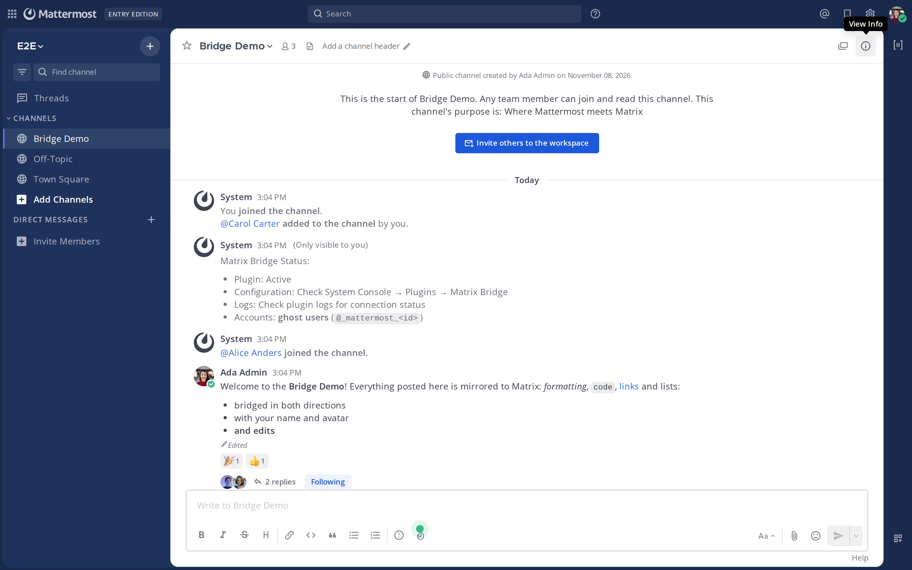
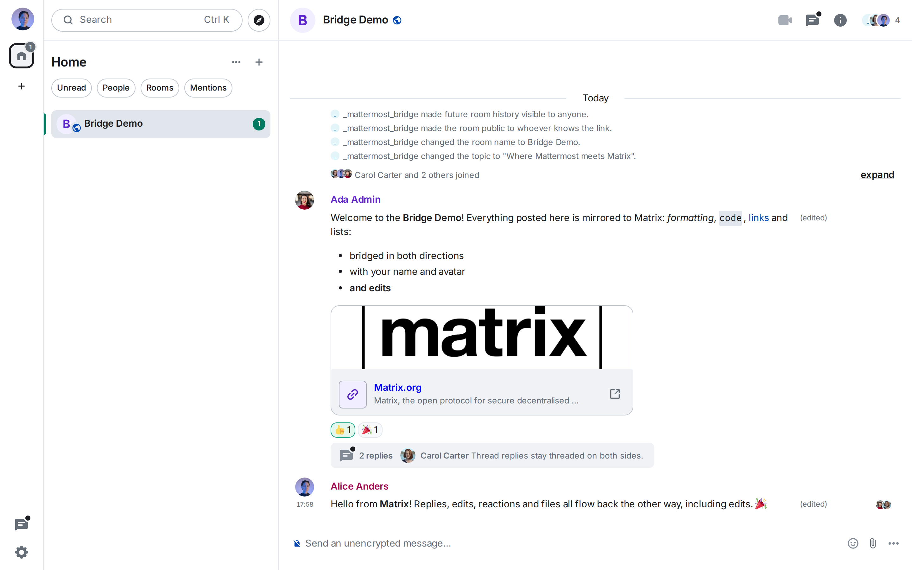
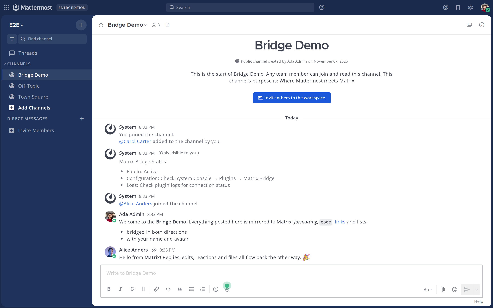
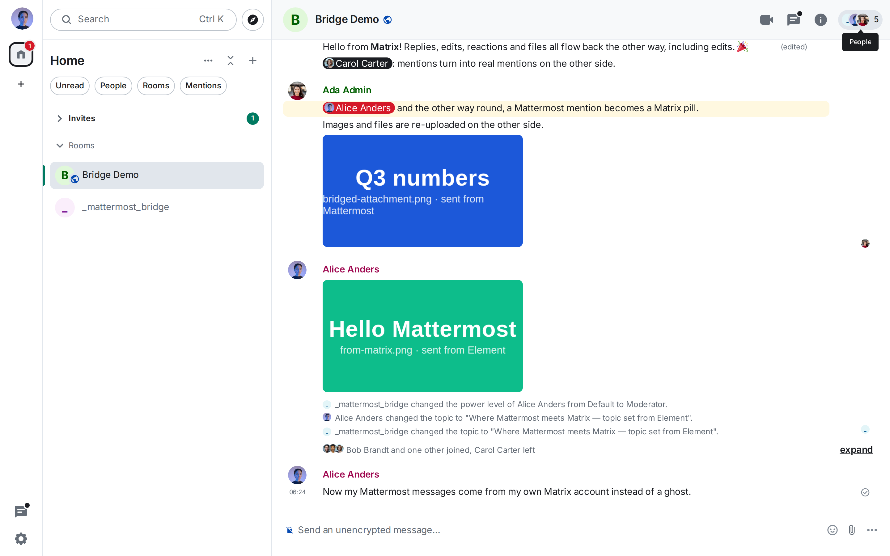

# Mattermost bridge for Matrix

[](https://github.com/mattermost/mattermost-plugin-matrix-bridge/actions/workflows/ci.yml)
[](https://github.com/mattermost/mattermost-plugin-matrix-bridge/actions/workflows/e2e.yml)

A Mattermost plugin that bridges Mattermost channels and Matrix rooms in both
directions. It runs inside your Mattermost server and talks to your Matrix
homeserver as a Matrix [Application Service](https://spec.matrix.org/latest/application-service-api/),
so Mattermost users appear in Matrix as real-looking puppet ("ghost") users and
Matrix users appear in Mattermost as remote users with their names and avatars.

## See it in action

The same conversation in Mattermost and in Element, with messages, threads,
reactions and avatars flowing both ways. These screenshots are regenerated
from the current code by the [walkthrough](docs/WALKTHROUGH.md), which also
covers setup on both sides step by step.

| Mattermost | Element |
| --- | --- |
|  |  |
|  |  |

Setting it up takes a plugin upload, one settings page and one file on the
homeserver; the full tour, from install to identity linking, is in
[docs/WALKTHROUGH.md](docs/WALKTHROUGH.md).

## What is bridged

| Feature | Mattermost → Matrix | Matrix → Mattermost |
|---------|:-------------------:|:-------------------:|
| Messages with formatting (Markdown ↔ HTML) | ✅ | ✅ |
| Edits | ✅ | ✅ |
| Deletions / redactions | ✅ | ✅ |
| Threads / replies | ✅ | ✅ |
| Reactions (4,400+ emoji) | ✅ | ✅ |
| File, image, audio and video attachments | ✅ | ✅ |
| @-mentions (`m.mentions`) | ✅ | ✅ |
| User display names and avatars | ✅ | ✅ |
| Membership (join and leave) | ✅ | ✅ |
| One identity on both sides (`/matrix link`, double puppeting) | ✅ | ✅ |
| Channel ↔ room creation, team ↔ space | ✅ | — |
| Room name and topic → channel name and header | — | ✅ |
| Typing notifications | — | ✅ |
| Presence → Mattermost status | — | ✅ |
| Direct and group messages | ✅ | — |
| Read receipts | — | — |
| End-to-end encrypted rooms | — | — |

Loop prevention is built in: every bridged message is tagged on both sides and
echoes are dropped.

The authoritative, test-enforced list is [docs/CAPABILITIES.md](docs/CAPABILITIES.md):
the end-to-end suite probes every capability, including the gaps, so the
document can never drift from what the bridge does. Planned work to close the
gaps and to integrate deeper on both sides is in [docs/ROADMAP.md](docs/ROADMAP.md).

## Requirements

- Mattermost server 10.7.1 or newer. Shared Channels (Connected Workspaces,
  Professional/Enterprise) is optional; it adds attachment and profile-image
  sync through Mattermost's own sync framework. Without it the bridge runs in
  hooks-only mode and still bridges everything in the table above.
- A Matrix homeserver that supports Application Services (Synapse, Dendrite,
  Conduit/conduwuit). Tested against Synapse.
- Network access from the Mattermost server to the homeserver's client API,
  and from the homeserver to the Mattermost site URL.

## Quick start

### 1. Mattermost side

1. Download the latest release and upload it in **System Console → Plugins →
   Plugin Management**, or run `make deploy` against a dev server.
2. Open **System Console → Plugins → Mattermost bridge for Matrix** and set:
   - **Matrix Server URL**: the homeserver's client API URL as seen from the
     Mattermost server, e.g. `https://matrix.example.com`.
   - **Matrix Server Name**: only if the domain in your Matrix user IDs differs
     from the URL hostname (e.g. `example.com` for `@alice:example.com`).
   - Click **Regenerate** for both the **Application Service Token** and the
     **Homeserver Token**.
   - Turn on **Enable Message Sync** and **Save**.
3. Click **Download Registration File**. It contains the two tokens, the
   plugin's callback URL (`<site URL>/plugins/com.mattermost.plugin-matrix-bridge`)
   and the user namespace the bridge owns.

### 2. Matrix side

1. Copy the downloaded `mattermost-bridge-registration.yaml` to your
   homeserver, e.g. `/data/mattermost-bridge-registration.yaml`.
2. Reference it from `homeserver.yaml`:

   ```yaml
   app_service_config_files:
     - /data/mattermost-bridge-registration.yaml
   ```

3. Restart the homeserver. Synapse logs `Loaded application service` on
   startup; it will deliver events, typing and presence to the plugin and let
   the plugin act as `@_mattermost_*` users.

### 3. Verify and connect a channel

In any Mattermost channel:

```
/matrix test                           # checks URL, tokens and appservice permissions
/matrix create                         # create a Matrix room for this channel
/matrix map #room:example.com          # or bridge an existing room (bot must be able to join)
/matrix list                           # show all mappings
/matrix unmap                          # stop bridging this channel
```

People who use both networks can link their accounts with `/matrix link`
and, optionally, let the bridge post as their own Matrix account; see
[docs/COMMANDS.md](docs/COMMANDS.md#identity-matrix-link-and-matrix-unlink).

New public and private channels get a Matrix room automatically, and new teams
get a Matrix space. See [docs/COMMANDS.md](docs/COMMANDS.md) for every command.
Bridging commands require permission to manage the channel; `map_user`,
`backfill`, `migrate` and `metrics` require a system administrator.

## Configuration reference

| Setting | Description |
|---------|-------------|
| Matrix Server URL | Client API URL of the homeserver. |
| Matrix Server Name | Domain of Matrix user IDs when it differs from the URL hostname. |
| Application Service Token | Token the plugin uses to act as ghost users. Goes into the registration as `as_token`. |
| Homeserver Token | Token the homeserver presents to the plugin. Goes into the registration as `hs_token`. |
| Enable Message Sync | Master switch for both directions. |
| Matrix User Prefix | Prefix of Mattermost accounts created for Matrix users (default `matrix`). |
| Matrix Rate Limiting | How aggressively the plugin throttles requests to the homeserver. |
| Mirror Mode (experimental) | Takes over a dedicated homeserver and creates real `@username` accounts instead of ghosts. See [docs/MIRROR_MODE_SETUP.md](docs/MIRROR_MODE_SETUP.md). |

## Development

```bash
make dist          # build server, webapp and the plugin bundle
make test          # Go and webapp unit tests
make check-style   # golangci-lint and eslint
make e2e           # Complement end-to-end suite (Docker required)
make walkthrough   # regenerate the docs/WALKTHROUGH.md screenshots in a browser
./scripts/local-setup.sh   # Mattermost + Synapse + Element with the plugin installed
```

- [docs/WALKTHROUGH.md](docs/WALKTHROUGH.md): a screenshot tour from install
  to identity linking, regenerated automatically from the current code.
- [LOCAL_DEVELOPMENT.md](LOCAL_DEVELOPMENT.md): the Docker Compose dev stack.
- [e2e/README.md](e2e/README.md): the end-to-end suite, which deploys Synapse
  through [Complement](https://github.com/matrix-org/complement) and a real
  Mattermost server, then exercises every bridged feature in both directions.
- [docs/ARCHITECTURE.md](docs/ARCHITECTURE.md): components, data flow and
  storage layout.

Regenerate emoji mappings with `make generate-emoji` and Go mocks with
`make mock`.

## Troubleshooting

- `/matrix test` fails: check that the Mattermost server can reach the Matrix
  Server URL and that `as_token` in the registration matches the plugin.
- Matrix → Mattermost does nothing: the homeserver must be able to reach the
  Mattermost **Site URL**. Check the homeserver log for appservice delivery
  errors; the plugin answers `401`/`403` when `hs_token` does not match.
- Ghost users have the wrong domain: set **Matrix Server Name** to the
  homeserver's `server_name`.
- Enable the plugin's debug logging (System Console → Logging) or set
  `MM_MATRIX_LOG_FILESPEC` to write every received appservice transaction to a
  file.

## Support

- [GitHub Issues](https://github.com/mattermost/mattermost-plugin-matrix-bridge/issues)
- [Matrix specification](https://spec.matrix.org/)
- [Mattermost plugin documentation](https://developers.mattermost.com/integrate/plugins/)

## License

MIT License - see [LICENSE](LICENSE).
